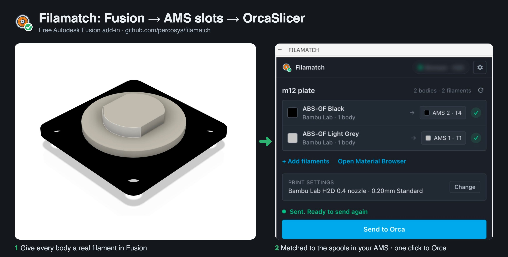

  

<h1 align="center">Filamatch</h1>

  Give every body in your Autodesk Fusion design a real filament, match it to
  the spools loaded on your printer, and send the design to OrcaSlicer ready to print.

  <a href="https://github.com/percosys/filamatch/releases/latest">Download</a> ·
  <a href="docs/user-guide.md">User guide</a>

  

> **New in 0.6:** printers with several nozzles (Bambu Lab H2C, H3C, X2D,
> Prusa XL, CORE One INDX, and in 0.6.1 the Snapmaker U1) and **Send to
> PrusaSlicer** with each body on its
> extruder. These are checked in the slicers, not yet on the printers: see
> [Printers](#printers) for what is tested.
>
> **New in 0.5.1:** after sending, Filamatch shows the print time and the
> grams of each filament, and checks that your spools have enough. Several
> spools of the same filament count together when AMS auto refill is on.
>
> **New in 0.5:** send to the slicer you pick (**Send to Orca**, **Send to
> Bambu**); Bambu Studio prepares Bambu Lab projects by itself, without
> OrcaSlicer. Each filament stays on the nozzle its AMS slot feeds, purge
> volumes fit the real colours, and every export checks that each body has
> the filament it has in Fusion. See the [changelog](CHANGELOG.md).

## Why

A multi-colour print usually goes like this: you design in Fusion, export a
3MF, open it in the slicer, and then assign a filament to every part again,
by hand, every time. Filamatch keeps that information in the design:

1. In Fusion you give each body a filament material (for example
   *Bambu Lab · PLA Basic · Black*). The model shows the real colour.
2. Filamatch reads which filaments are loaded in your printer's AMS slots
   and matches each design filament to a slot.
3. **Send to Orca** exports the design with each body already assigned to its
   slot, prepares the printer and process settings, and opens OrcaSlicer.
   The button names the slicer you pick in Settings, for example **Send to
   Bambu**.

## Features

**In Fusion**
- One palette with a live list of the filaments in the open design: body
  count, matched printer slot and a match badge (✓ match, ≈ close colour,
  "Not loaded"). Change a slot with one click.
- The list follows your changes: assigning a material, undo/redo and
  switching designs update it without a refresh button.
- A ready check before you send, with a fix button for each problem.

**Filaments**
- Add filaments from three places: the spools **on your printer**, the
  bundled **catalog**, or a **search** of the community
  [Open Filament Database](https://github.com/OpenFilamentCollective/open-filament-database).
- Each filament becomes a Fusion physical material with the right colour
  and density (so mass and weight estimates are correct), saved in your
  Fusion Favorites and in a "Filamatch Library" material library.

**Printer and slicer**
- Reads the filaments loaded in your Bambu Lab printers: every AMS, AMS 2
  Pro and AMS HT slot and the external spool, with the left and right nozzle
  on an H2D. Several printers at once. Two ways to connect:
  - **directly to the printer** on your network, with its IP address and
    access code from the printer screen. Tested in LAN-only mode; developer
    mode is not needed. Cloud mode on the same network should also work
    (Bambu still allows other apps to read the printer status), but it is not
    tested yet. Filamatch checks the printer's Bambu Lab certificate.
  - or through [Bambuddy](https://github.com/maziggy/bambuddy), a self-hosted
    Bambu Lab printer manager. Slots with a Bambuddy inventory spool also
    show grams left.
- Filament names come from the filament id the printer reports, looked up
  in your installed Bambu Studio and OrcaSlicer presets (your own presets
  too).
- Prepares a complete OrcaSlicer project: printer, process and filament
  presets from your installed OrcaSlicer (or Bambu Studio) or downloaded from
  OrcaSlicer's profile collection. Picks a build plate and wipe tower position
  the filaments accept.
- Opens the result in OrcaSlicer.

**Under the hood**
- Slow work (printer queries, profile downloads, the slicer run) happens in
  the background, so Fusion never freezes.
- The Bambuddy API key and the printer access codes are stored in the
  macOS Keychain or the Windows Credential Manager, never in a plain
  settings file.
- Printer connections only read. Filamatch never sends a command that moves,
  heats or prints.
- A standalone command-line tool adds slot metadata to any 3MF (see
  [How it works](docs/how-it-works.md#the-3mf-injector-command-line-tool)).

## Requirements

| | |
|---|---|
| **Autodesk Fusion** | Current release, macOS or Windows. Filamatch uses Fusion's built-in Python; nothing else to install. |
| **OrcaSlicer or Bambu Studio** | Prepares the project (print settings, slots, nozzles, purge volumes) and opens it; the send button names the one you pick. Bambu Studio prepares Bambu Lab printers by itself; other printers need OrcaSlicer. Other slicers get the plain 3MF. Without a slicer you can still export a tagged 3MF. |
| **A Bambu Lab printer** (optional) | To read the filaments loaded in the printer. Connect it directly (IP address and access code from the printer screen) or through [Bambuddy](https://github.com/maziggy/bambuddy). See [Printers](#printers) for what is tested. Without a printer, an export puts the filaments in slots 1, 2, 3… in the order they appear in the design. Other printer brands are on the [roadmap](docs/roadmap.md). |

Windows support is written but has been tested less than macOS.

## Printers

Any printer works for the basics: Filamatch writes a 3MF in which each body
already has its filament, and the slicer does the rest. Reading the loaded
spools, choosing the nozzle for each filament and the spool check depend on
the printer.

**1. Tested and validated on a real printer:**

| Printer | What is tested |
|---|---|
| Bambu Lab H2D (AMS 2 Pro, AMS HT) | Loaded spools (LAN-only mode and Bambuddy), Send to Orca (OrcaSlicer 2.5), Send to Bambu (Bambu Studio 2.9.1), each filament on the nozzle its AMS feeds, print estimate and spool check |
| Bambu Lab X1 Carbon (AMS) | Loaded spools |

**2. Checked in the slicers with test files, not yet on a real printer:**

| Printer | What is checked | Not tested |
|---|---|---|
| Bambu Lab H2C | Send to Bambu and Send to Orca prepare the project; Bambu Studio 2.9.1 opens it with each filament on its AMS side and slices it; the estimate works | Loaded spools, printing |
| Bambu Lab H3C | Send to Bambu prepares the project; Bambu Studio 2.9.1 opens it with its 9 nozzles and slices it; the estimate works. OrcaSlicer 2.5 cannot slice the H3C, so Filamatch refuses it | Loaded spools, printing |
| Bambu Lab X2D | Send to Bambu and Send to Orca prepare the project; Bambu Studio 2.9.1 opens it with each filament on its AMS side; the estimate works | Slicing in the app, loaded spools, printing; the "(L)" / "(R)" labels may be swapped (Bambu Studio says "Main" and "Auxiliary") |
| Prusa XL 5T | Send to Orca prepares the project with Prusa's filament presets; OrcaSlicer 2.5 opens and slices it; the estimate matches | Loaded spools (not read from Prusa printers), printing |
| Prusa CORE One INDX 4T / 8T, MMU3 | Send to Orca prepares the project and estimates it (OrcaSlicer 2.5 command line) | Opening in the app; the INDX 8T estimate often fails because OrcaSlicer crashes; printing |
| Snapmaker U1 (0.4 nozzles, and 0.4 + 0.6 nozzles) | Send to Orca prepares the project with each body on its tool and estimates it (OrcaSlicer 2.5 command line). The 0.4 set gets Snapmaker's filament presets; the mixed set gets OrcaSlicer's generic ones, because Snapmaker's presets list only the 0.4 U1 | Opening in the app, the Snapmaker Orca app, loaded spools, printing |
| Any printer in PrusaSlicer | Send to PrusaSlicer keeps each body on its extruder (PrusaSlicer 2.6.0) | PrusaSlicer 2.9, SuperSlicer |

**3. Expected to work, not tested yet:**
- Other Bambu Lab printers with one nozzle and an AMS (P1S, P1P, A1,
  A1 mini, X1E, H2S, P2S): the same printer connection and slicer presets
  as the tested printers.
- Printers whose slicer is OrcaSlicer or based on it (for example
  Creality Print, ElegooSlicer, Anycubic Slicer Next, Snapmaker Orca,
  QIDI Studio): these use the same project layout, so the slots should be
  kept. Filamatch does not read the loaded spools of these printers yet.

Other tool changers (Klipper tool changers, IDEX printers) get the plain
3MF with each body's filament; Filamatch does nothing printer-specific for
them yet.

The plan for multi-nozzle and tool-changer printers is in
[docs/design/multi-nozzle.md](docs/design/multi-nozzle.md).

### Help add your printer

Do you own a printer that is not in the tested list? You can help add it:

1. Open a [printer support issue](https://github.com/percosys/filamatch/issues/new?template=printer-support.yml).
2. The form asks for the printer model and firmware, your slicer and its
   version, the diagnostics report, a small project saved by your slicer
   with your printer selected, and (if you can) the printer's status report.
3. Remove serial numbers, access codes, IP addresses and API keys before
   you post anything.

A printer moves to the tested list when an owner has confirmed the full
flow: loaded spools, send, slots in the slicer and the print.

## Install

1. Download `Filamatch-<version>.zip` from the
   [releases page](https://github.com/percosys/filamatch/releases) and unzip it.
   You get a folder named `Filamatch`.
2. Move that folder into Fusion's add-ins folder:
   - **macOS:** `~/Library/Application Support/Autodesk/Autodesk Fusion 360/API/AddIns/`
   - **Windows:** `%APPDATA%\Autodesk\Autodesk Fusion 360\API\AddIns\`
3. Restart Fusion. Filamatch starts by itself. Its button is on the
   **UTILITIES** tab, **ADD-INS** panel.

From a clone of this repository you can run the installer instead:
`scripts/install_addin_macos.sh` (macOS) or
`powershell -ExecutionPolicy Bypass -File scripts\install_addin_windows.ps1` (Windows).

## Quick start

1. Open a design and click **Filamatch**.
2. The first time, connect your Bambu printer (IP address and access code
   from the printer's network settings), connect Bambuddy, or skip. You can
   change it later in **Settings > Printer**.
3. Click **+ Add filaments** and add the filaments you print with.
4. In Fusion, give each body one of those materials (Physical Material,
   or **Open Material Browser** in the palette).
5. Check the slots on Home, then click **Send to Orca**.

The [user guide](docs/user-guide.md) explains every screen.

## Privacy and network use

Filamatch has no account, no analytics and no telemetry. It only connects to:

- **your printers**, at the IP addresses you enter (port 8883, encrypted);
- **your Bambuddy server**, at the address you enter;
- **raw.githubusercontent.com**, to download OrcaSlicer printer profiles you
  pick that are not installed locally;
- **api.openfilamentdatabase.org**, when you search online filaments.

Settings live in your user folder (see
[file locations](docs/how-it-works.md#file-locations)).

## Documentation

- [User guide](docs/user-guide.md): every screen, troubleshooting, slicer compatibility.
- [How it works](docs/how-it-works.md): architecture, 3MF metadata, file locations.
- [Roadmap](docs/roadmap.md): planned features.
- [Development](docs/development.md): project layout, tests, releases.
- [Changelog](CHANGELOG.md) · [Contributing](CONTRIBUTING.md)

## Support

Filamatch is free and open source. If it saves you time, you can buy me a
coffee:

Bug reports and test results from other printers help just as much: see
[CONTRIBUTING](CONTRIBUTING.md).

## License and credits

Filamatch is released under the [MIT License](LICENSE). © 2026 Percosys.

- Filament data from the [Open Filament Database](https://github.com/OpenFilamentCollective/open-filament-database) (MIT), downloaded when you search.
- Printer profiles from [OrcaSlicer](https://github.com/OrcaSlicer/OrcaSlicer) (AGPL-3.0), downloaded when you pick a printer that is not installed; they are not part of this repository.
- Printer data from [Bambuddy](https://github.com/maziggy/bambuddy), when you connect it.
- Bambu Lab CA certificates (`Filamatch/data/bambu_ca.pem`) from [ha-bambulab](https://github.com/greghesp/ha-bambulab) (MIT), used to check that a printer is a real Bambu Lab printer.

Filamatch is an independent project. It is not made, endorsed or supported by
Autodesk, Bambu Lab or the OrcaSlicer project. Autodesk and Fusion are
trademarks of Autodesk, Inc.
