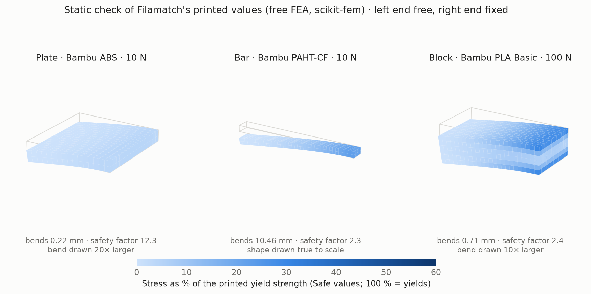

# The stiffness and strength model

The "Printed weight and strength" card estimates each body's stiffness and
strength **as printed**. While the switch "Fusion uses the printed values" is
on, each body's own "… · as printed" material gets them, next to its printed
density. Fusion Simulation then uses them.

**These are rough estimates (±25–40 %), never design values.** Check
important parts with a test print.

The code is `Filamatch/lib/strength_model.py`. The data is
`Filamatch/data/as_printed_materials.json` (tier 1, generic) and Filamatch's
`Filamatch/data/datasheets/` (tier 2, one product's own data sheet).

## How it works

1. **The filament's own data sheet (tier 2).** When the body's filament is
   a product in Filamatch's data sheets (Bambu Lab and Polymaker for now),
   its own values are the base. Maker and product must match exactly: from
   the Filamatch material's description ("Bambu Lab - PAHT-CF - Black") or
   its display name, with the colour left off. "Polymaker ASA (PolyLite ASA)"
   is found under both names; Fiberon products under Polymaker and Fiberon.
   The body line says "from its own data sheet". ±25 %: the sheet is exact
   for its bars, but the infill model is not.
2. **Else the filament type (tier 1).** It comes from Filamatch's catalog
   (the slicer filament type, for example PLA, PETG-CF or PA6-CF). For other
   materials it comes from the material's name ("ABS Plastic" is ABS). The
   body line says when the name was used. The type's base values, for printed
   solid test bars along the layers (XY) and across them (Z), are the median
   of its data sheets. Its range is their lowest and highest value.
3. **The case.** Fusion Simulation uses one value for every direction. So
   you choose:
   - **Safe** (the default): the weakest bar of the data sheets, across the
     layers (Z) or, when a sheet says that is lower, along them. Printed parts
     break across the layers first. For a nylon whose sheet gives moist
     (conditioned) values, Safe uses those.
   - **Typical:** the average of the XY and Z medians (dry for nylons).
4. **Layer height.** The data sheets test at about 0.2 mm layers with a
   0.4 mm nozzle. Thicker layers bond less. The Z strength is scaled by
   `k(r) / k(2)`, with `k(r) = 1 − 0.82 · r^−1.5` and `r` = nozzle / layer
   height (Kuznetsov et al. 2018, PLA). It never goes above the data sheets.
5. **Shell and core.** The mass model splits each body into a solid shell
   (walls, top and bottom) and an infill core. The core keeps a share of the
   solid value: `C · ρ^n` for stiffness and `C' · ρ^m` for strength, with ρ
   the infill fraction. Above 75 % infill the share goes in a straight line
   to solid at 100 %. The part's value mixes shell and core by volume:
   `E = E_solid · (φ_shell + φ_core · C · ρ^n)`.
6. **For Fusion:** Young's modulus, Poisson's ratio, the shear modulus
   `G = E / 2(1 + ν)`, and yield and tensile strength. Yield is taken as the
   tensile strength (the highest stress of the printed bars). Fusion's safety
   factor uses yield by default. Each copy is set to isotropic, because
   Simulation uses only isotropic materials.

## Infill patterns

| Pattern (and the slicer names that use it) | Stiffness `C · ρ^n` | Strength `C' · ρ^m` | Source |
|---|---|---|---|
| Gyroid (TPMS-D, TPMS-FK) | 0.79 · ρ^1.68 | 0.3 · ρ^1.5 | Stiffness: fit to the measured points of Bean, Lopez-Anido & Vel 2022, Appl. Sci. 12:2180 (PLA, compression). Strength: Gibson & Ashby foam law. |
| Grid (rectilinear, line, zig-zag, cross zag, locked zag, Archimedean chords, Hilbert curve, octagram spiral) | 0.65 · ρ^1.55 | 2.0 · ρ^2.71 | Fit to León-Becerra, González-Estrada & Quiroga 2021, ACS Omega 6:30993, Table 2 (PLA, in-plane compression, ρ 0.29–0.62). |
| Triangles (tri-hexagon, stars) | 0.25 · ρ^1.02 | 0.735 · ρ^1.73 | Same paper (ρ 0.24–0.45). |
| Honeycomb (lateral honeycomb) | 0.46 · ρ^3.29 | 0.60 · ρ^2.72 | Same paper (ρ 0.36–0.67); the weak, in-plane direction. |
| Lightning | 0 | 0 | Assumed: lightning only holds up the top skins. |
| Everything else (cubic, adaptive cubic, quarter cubic, support cubic, 3D honeycomb, concentric, cross hatch, lateral lattice) | ρ^2 | 0.3 · ρ^1.5 | Gibson & Ashby, Cellular Solids, 2nd ed. (1997), open-cell foam law. |

## Base values (generic, tier 1)

All values are for printed test bars from the makers' data sheets, read on
2026-11-08 and typed in by hand. Each number was checked against the data
sheet's text (and the page image for the BASF sheet). Medians, with the
range and the number of data sheets:

| Type | E XY (MPa) | E Z (MPa) | Tensile XY (MPa) | Tensile Z (MPa) | ± | Data sheets |
|---|---|---|---|---|---|---|
| PLA | 2965 (2300–3427, 4) | 3065 (2160–3071, 3) | 51.7 (39–52.5, 4) | 35 (33.1–40.5, 3) | 30 % | Bambu Lab PLA Basic, Polymaker PolyLite PLA, Prusament PLA, UltiMaker PLA |
| PETG | 1810 (1460–2117, 5) | 1626 (1120–1899, 4) | 47 (34–50.8, 5) | 31 (19–42.8, 4) | 35 % | Bambu Lab PETG Basic and PETG HF, Polymaker PolyLite PETG, Prusament PETG, UltiMaker PETG |
| ABS | 2200 (1962–2247, 3) | 1960 (1699–2081, 3) | 38.1 (33.4–41, 3) | 29.7 (19–32, 3) | 30 % | Bambu Lab ABS, Polymaker PolyLite ABS, UltiMaker ABS |
| ASA | 2379 (1600–2450, 3) | 2043 (1965–2120, 2) | 43.8 (42–52, 3) | 33.5 (32–35, 2) | 30 % | Bambu Lab ASA, Polymaker PolyLite ASA, Prusament ASA |
| PC | 2252 (1900–2497, 4) | 2255 (1450–2371, 3) | 62.5 (53.3–69.1, 4) | 52.8 (25.2–56, 3) | 35 % | Bambu Lab PC, Polymaker PolyLite PC, Prusament PC Blend, UltiMaker PC |
| PA-CF (dry) | 4430 (3311–8637, 5) | 2180 (1807–3760, 5) | 102 (77.4–109.3, 5) | 52.2 (18.2–64, 5) | 40 % | Bambu Lab PA6-CF and PAHT-CF, Polymaker Fiberon PA6-CF20 and PA12-CF10, BASF Ultrafuse PAHT CF15 |
| PETG-CF | 3085 (2460–3710, 2) | 1996 (1340–2652, 2) | 59.4 (59–59.8, 2) | 39.6 (38–41.1, 2) | 40 % | Bambu Lab PETG-CF, Polymaker Fiberon PETG-rCF08 |
| PLA-CF | 2945 (2790–3281, 3) | 2187 (2160–2213, 2) | 31.2 (28.3–38, 3) | 15.1 (12.5–26, 3) | 40 % | Bambu Lab PLA-CF, Polymaker PolyLite PLA-CF, Overture CF PLA |

The URLs, test standards, specimens and print settings of every data sheet
are in the data file. Notes:

- Strength is the highest stress of the bar: the yield stress where the data
  sheet gives one higher than the break stress.
- Prusament's "vertical" bars are printed on edge, so they are not Z values.
  Prusament's interlayer adhesion uses its own method and is not used.
- PA-CF values are dry. Moist polyamide is about half as strong (Polymaker).
  The PA-CF modulus has two groups (3.3–4.4 and 8.4–8.6 GPa), so one generic
  value is weak.
- Poisson's ratio: PLA 0.35 (Gaweł et al. 2023, Polymers 15:1651), ABS and
  PC 0.36 (Cantrell et al. 2017, Rapid Prototyping Journal). No measurement
  was found for PETG, ASA and the CF types; they use 0.35–0.36 and the data
  file says so.

## Tier 2: the makers' own data sheets

Filamatch keeps them in `Filamatch/data/datasheets/` (format and rules in its
README; each value has its sheet's URL, version and test standard). The model
reads tensile modulus and tensile strength (or yield, where higher) along and
across the layers, in MPa, GPa, psi or ksi, dry and conditioned. Notes:

- Bambu Lab ASA Aero is left out: its test bars were dense, but a print
  foams.
- Only XY and Z bars are read. An on-edge "XZ" bar (Prusament's "vertical")
  still has its layers along the bar, so it is not Z. Sheets with values
  without a direction (often molded bars) are not used.
- A sheet with strength but no tensile modulus (many eSun, Elegoo and Sunlu
  sheets) takes its stiffness from the generic type's medians and says so;
  without a generic type it is not used.
- A sheet without Z values (Prusament) gets them estimated: its XY value
  times the generic type's Z/XY ratio, or, for a type without generic data
  (PA11, PEI, PP-CF …), the lowest ratio of the generic types. ±30 %, and
  the sources list says so. Without this, Safe would use the along-the-layers
  value and be less safe than the generic type.
- Bambu Lab nylons give dry values only; the card says moist nylon is weaker.
- Bambu Lab PPA-CF and PPS-CF bars were not annealed; the sheets say a hotter
  chamber gives more, mostly in Z.
- Products without a tier-1 type (ABS-GF, ASA-CF, PET-CF, PPA-CF, PPS-CF,
  PA-GF, PC-ABS, PC-PBT, PET-GF, PPS-GF) get values from their own sheet;
  their Poisson's ratio is 0.36 (assumed).

## Not in the data yet

- **Flexible filaments (TPU, TPE, ...):** the makers' moduli differ by
  seven times (9 to 67 MPa), and a linear simulation does not fit a
  rubber-like part. These bodies get no printed values; the body line warns
  that Fusion keeps the material's own values.
- Glass-fibre types, PCTG, HIPS, PVA, PET-CF and plain PA, unless the
  product has its own data sheet (tier 2).
- A filament with neither a data sheet nor a type (for example Fusion's
  "Nylon 6/6") uses its own Fusion values, scaled for the infill like the
  others, ±60 %. Not for Filamatch's own filament materials without data:
  their values are a colour template's, so they get none. These are often for molded parts, so they are too strong
  for a print; the body line warns. Without its own values a body gets none,
  and the body line says so. (Before, such a copy kept the solid values next
  to the printed density, which looked safer than it is.)

## Known limits

- The pattern fits come from compression tests on PLA. Tension and other
  filaments may differ.
- The mix by volume is for tension. In bending the shell carries more, so
  bending stiffness is often higher than the estimate.
- No source validates one shell-plus-infill formula for all patterns. A check
  against 12 printed tensile bars (Pandžić et al. 2021, triangles, 20–100 %)
  gave E −35 % to +20 % and strength −31 % to +60 %.
- Fusion may compute the shear modulus itself in Simulation (not checked).

## What is tested

- Self-tests: `python3 -m Filamatch.lib.strength_model` (the data rules, the
  median and range, safe and typical, the patterns, the layer bond, solid at
  100 %, the data sheets: units, dry and moist, exact names), `material_copy` (Fusion's units, isotropic, putting the filament's
  values back) and `as_printed_bridge` (a data sheet by description or
  display name, types from the catalog and from the name, the case per design).
- In Fusion (2706.1.17): the copies get E, shear modulus, Poisson's ratio,
  yield and tensile strength in Fusion's own units, isotropic; Safe and
  Typical change them in place; the switch off removes them. A Static Stress
  study's Study Materials use the copies ("Same as Model") with exactly
  these values. The study was not solved: Fusion solves in the cloud only,
  and the account had no Flex tokens.
- Static check with a free FEA program instead,
  `scripts/as_printed_static_check.py` (scikit-fem): three test parts with
  the values Filamatch wrote, each fixed at one end with a force on its top.
  The deflections match beam theory within 1.5–8 % (the wide plate is
  stiffer than a beam), the safety factors 2.3 (bar), 2.4 (block) and 12
  (plate). So Fusion gets values that behave as this model says.

  

- Not tested yet: real printed parts.
