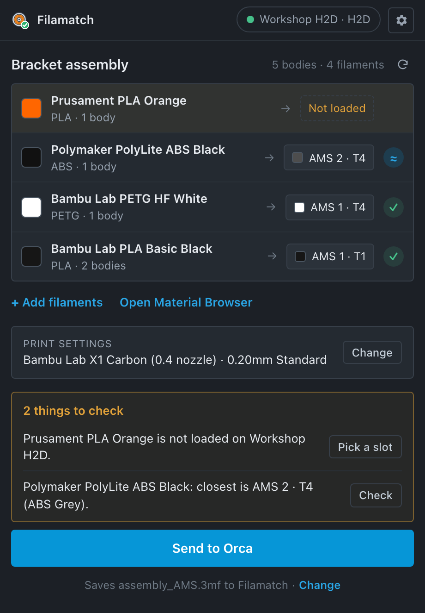
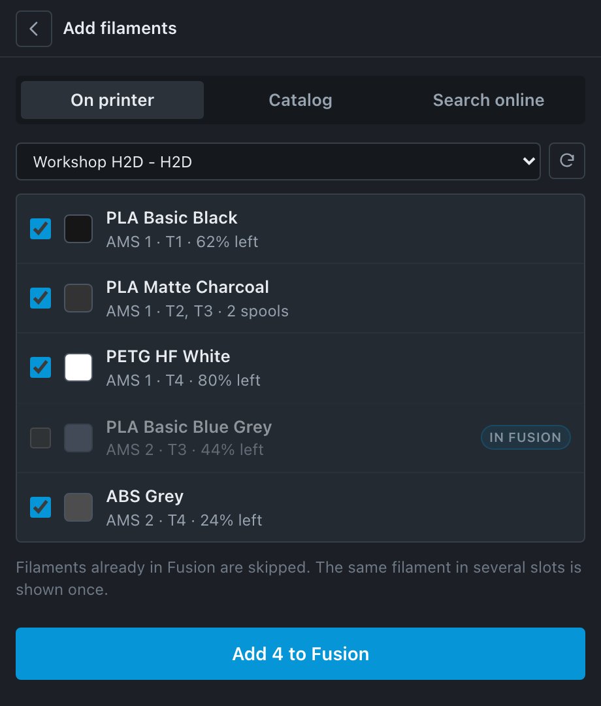
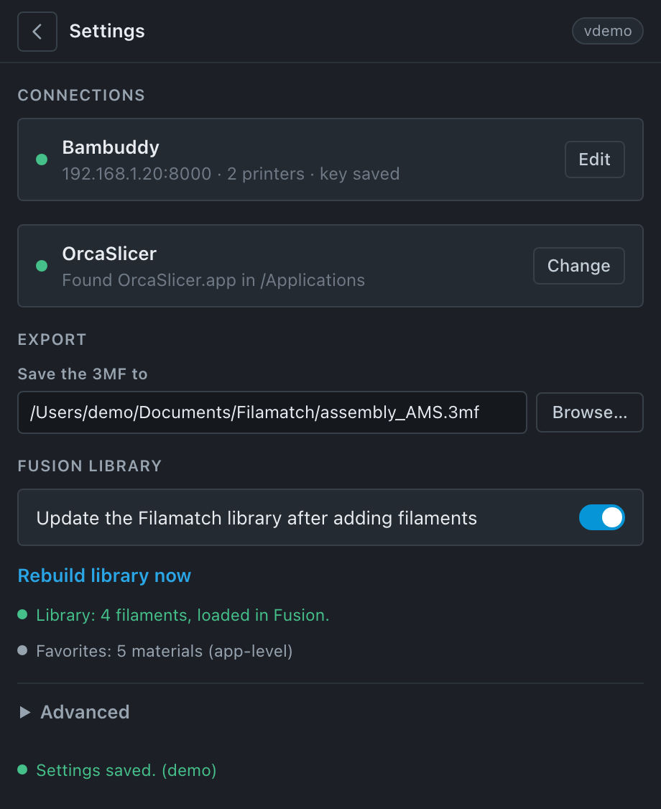

# User guide

Filamatch is one palette in Autodesk Fusion. Click **Filamatch** on the
**UTILITIES** tab, **ADD-INS** panel to open it. It opens as a floating window
that fits its content; you can dock it like any Fusion palette.

- [First start](#first-start)
- [Home](#home)
- [Add filaments](#add-filaments)
- [Settings](#settings)
- [Which slicers can open the files](#which-slicers-can-open-the-files)
- [Troubleshooting](#troubleshooting)
- [Known limits](#known-limits)

## First start

When nothing is set up yet, Filamatch shows a short welcome:

1. **Connect a Bambu printer.** Filamatch reads the printer directly on your
   network. See [Add a Bambu printer](#add-a-bambu-printer).
2. **Or connect Bambuddy.** Enter the address of your Bambuddy server (for
   example `http://192.168.1.20:8000`) and an API key created in Bambuddy.
   Filamatch then reads your printers and every loaded slot. A slot with a
   Bambuddy inventory spool linked also shows that spool (grams left,
   preset).
3. **Or skip.** You can still add filaments from the catalog. Without a printer
   connection, an export puts the filaments in slots 1, 2, 3… in the order
   they appear in the design. Connect later in Settings.

### Add a Bambu printer

You need two things from the printer screen: the **IP address** and the
**access code**. Both are on the network page of the printer settings
(**Network** or **WLAN**, depending on the model).

Filamatch is tested with printers in LAN-only mode. Developer mode is not
needed. Cloud mode should also work, because Bambu still allows other apps
to read the printer status, but it is not tested yet. If a printer in cloud
mode does not answer, please [open an issue](https://github.com/percosys/filamatch/issues).
The computer must be on the same network as the printer.

1. Open **Settings > Printer**, choose **Bambu printer (LAN)** and click
   **Add printer**.
2. Enter the IP address and the access code. Click **Test**. Filamatch shows
   the model and what is loaded in each AMS.
3. Give the printer a name (optional) and click **Save**. Add more printers
   the same way.

Filamatch checks that the printer has a certificate from Bambu Lab. If it
does not, Filamatch shows the certificate fingerprint and asks you to trust
it (**Trust this printer**). Trust it only if the IP address is your printer.

Filamatch only reads from the printer. It asks for a full status at most
every 20 seconds (every 5 minutes for P1 and A1 printers, which slow down when
asked more often).

## Home

**Top bar.** The printer pill shows the selected printer and whether it is
reachable. The gear opens Settings.

**This design.** One row for each filament used in the open design:

- the filament's colour, name and how many bodies use it;
- the printer slot it is matched to, with that slot's colour;
- a badge: **✓** the slot holds this filament, **≈** a close colour,
  **Not loaded** no slot holds it.

Click a slot to choose another one; your choice is remembered for that
filament. Rows that need attention are listed first.

The list updates by itself when you assign a material, undo, redo or switch
designs. The **↻** button reloads it by hand.

**Links.** **+ Add filaments** opens the add page. **Open Material Browser**
opens Fusion's Physical Material browser, where you assign the filaments to
bodies.

**Print settings.** One line with the printer, process and plate. **Change**
opens the printer, process and plate lists. They come from your installed
OrcaSlicer or Bambu Studio, or from OrcaSlicer's online profile collection.

**Ready check and Send to Orca.** Above the button you see "Ready to send" or
a short list of problems, each with a button that fixes it. Warnings never
block sending; only real blockers do (no open design, no filament assigned,
no slicer found). The button names the slicer you pick in Settings, for
example **Send to Orca** or **Send to Bambu**. It:

1. exports the design as a 3MF with each body assigned to its slot;
2. prepares a complete project for the chosen printer and process, with the
   slicer you picked (Bambu Studio prepares Bambu Lab printers itself; for
   other printers it needs OrcaSlicer installed);
3. adds a small slot record (which spool is in which slot);
4. opens the file in the slicer you picked.

A slicer other than OrcaSlicer or Bambu Studio (for example PrusaSlicer)
cannot open a prepared project, so it gets the plain 3MF.

The line below the button shows where the file is saved; **Change** picks
another place.

After a prepared send, the palette shows the print time and filament under
the button, for example "About 43 min and 6.9 g of filament (2.6 g + 4.3 g)".
Filamatch works it out by slicing a copy in the background after the slicer
has opened. The numbers come from the slicer, so they match what the slicer
shows when you slice.

Below it, the spool check compares each filament with the grams left on its
spool (from Bambuddy, or from the printer for Bambu RFID spools). It warns
when a spool has less than the estimate plus 10%, for example "Bambu Lab -
ABS-GF - Black may run out: needs 2.5 g, 1.0 g left (AMS 2 - T4 (R))".
Spools whose weight is not known are left out.

Several spools of the same filament (same colour and type, on the same
nozzle) count together:

- Filamatch picks the fullest of them for the print.
- The other spools are backups. If the picked spool is too short, the
  check adds the grams on the backups.
- A Bambu Lab AMS only switches to a backup spool when **AMS auto refill**
  is on in the printer settings. Filamatch reads this setting from the
  printer and says if it is on or off. When it is off, or not known, the
  line is a warning.

On a slow computer, turn this off in **Settings > Export**.

## Add filaments

Three tabs. Everything you add becomes a Fusion physical material with the
filament's colour and density, saved in your Fusion **Favorites** (available
in every design) and in the **Filamatch Library**.

- **On printer:** the spools loaded in the selected printer. Filaments that
  are already in Fusion are shown but skipped.
- **Catalog:** filaments that ship with Filamatch plus everything you added
  before. Search by name, filter by material.
- **Search online:** search the community Open Filament Database (thousands
  of filaments with colours, densities and temperatures). The first search
  downloads the database (about 16 MB); later searches also work offline.

Select filaments and click **Add to Fusion**. You return to Home.

## Settings

- **Printer:** where the printer slots come from.
  - **Bambu printer (LAN):** the printers you added, each with name, model
    and IP address. **Add printer** adds one; **Remove** forgets a printer and
    its access code.
  - **Bambuddy:** address and API key. **Edit** changes them; **Remove key**
    deletes the saved key. Turn off **Verify the HTTPS certificate** only for
    a Bambuddy on your own network with a self-signed certificate.
- **Slicer:** **Change > Send to** lists the slicers installed on your
  computer; **Other app…** picks any other slicer. The send button shows the
  name of the slicer you pick.
- **Export folder:** where the send button saves files.
- **Print time, filament and spool check after sending:** on by default.
  It slices a copy in the background (about 1 to 5 seconds on a fast Mac,
  longer on a slow computer); turn it off there.
- **Fusion library:** keep the Filamatch Library up to date after adding
  filaments, or rebuild it now.
- **Advanced:**
  - export only the 3MF without opening the slicer;
  - your own OrcaSlicer profile folder, or import profile files;
  - **Run diagnostics:** a report of versions, file locations and checks.
    Paste it into a bug report.
  - the session log.

## Which slicers can open the files

Tested on macOS:

| File | OrcaSlicer | Bambu Studio | PrusaSlicer / SuperSlicer |
|---|---|---|---|
| **Send to Orca / Send to Bambu** (prepared project) | Opens with slots | Opens with slots. Send to Bambu prepares with your own Bambu Studio; a file prepared by OrcaSlicer needs Bambu Studio 2.8 or newer | Does not open (gets the plain 3MF) |
| **Export only** (Advanced) | Opens with slots | Opens with slots | Opens, but slots are not kept |

PrusaSlicer support is on the [roadmap](roadmap.md).

## Troubleshooting

First run **Settings > Advanced > Run diagnostics** and look for lines that
are not OK. Log files: see [file locations](how-it-works.md#file-locations).

| Problem | What to do |
|---|---|
| No Filamatch button | Check the folder is named `Filamatch` and holds `Filamatch.py` and `Filamatch.manifest`. Restart Fusion. In **Scripts and Add-Ins** (Shift+S), Add-Ins tab, Filamatch should be running. |
| The palette shows "No printer" or "0 bodies" and nothing loads | Close the palette and open it again from the button. If it stays empty, stop and run Filamatch in Scripts and Add-Ins, or restart Fusion. |
| "Bambuddy not reachable" | Check the address in Settings (including `http://` or `https://` and the port) and that Bambuddy runs. Filamatch gives up after a few seconds, so Fusion does not freeze. |
| "The printer at … did not answer" | Check the IP address on the printer screen (it can change after a restart; give the printer a fixed address in your router). Check that the computer and the printer are on the same network. |
| "The printer refused the access code" | Read the access code again on the printer screen; it changes when it is refreshed there. Remove the printer and add it again. |
| "… is another printer now" | Two printers swapped IP addresses. Remove the printer and add it again with the new address. |
| One printer is missing slots, the others load | That printer did not answer. The log names it. The other printers still work. |
| A filament shows **Not loaded** | No slot holds that filament. Load it, or click the slot chip and pick a slot by hand. |
| Colours in the Material Browser look white or grey | Fusion draws the material preview once and cannot redraw it through its API. The model, the palette and the export use the right colour. Editing the appearance once in Fusion refreshes the preview. |
| `Template material ... was not found` | Filamatch copies a stock Fusion material. Make sure the *Fusion Material Library* is available in the Material Browser. |
| Printer preparation failed | The tagged 3MF is still saved (the error names the file). Check that OrcaSlicer is installed and that the printer and process exist in **Print settings > Change**. |
| "Filament assignments do not match Fusion" | Filamatch stopped the export because a body would print with another filament than in Fusion. The message names the body and the slot. Click Refresh and export again. If it happens again, run diagnostics and report it with the message. |
| The slicer refuses to slice mixed materials | A slicer safety rule for very different print temperatures. Turn on the slicer's option to allow mixed temperatures, or print the materials separately. |
| The profile list is empty | The online profile list needs internet. Installed OrcaSlicer/Bambu Studio profiles work offline, and you can import your own profile files in Advanced. |
| An unwanted favorite | Fusion's API cannot remove favorites. Remove it in Fusion: Physical Material > Favorites > right-click > Remove. |

## Known limits

- Direct printer connections: Bambu Lab printers only, on the same network
  as the computer. A printer that is only reachable through the Bambu cloud
  is not supported.
- One filament per body. Painting faces of one body in different colours is
  not supported.
- Up to 16 different filaments in one design (the slicer's limit).
- The Filamatch Library is a snapshot of your Fusion Favorites; Fusion's API
  cannot create library categories.
- Bodies that are not solid (surfaces) are not printed and are left out.
- Material previews in Fusion's Material Browser can show a stock swatch (see
  Troubleshooting).
